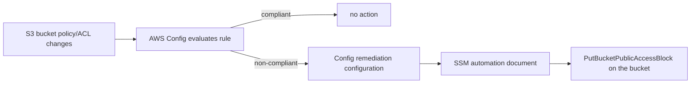

# Public S3 bucket auto-remediation

Terraform module that wires up AWS Config to detect publicly readable or writable S3
buckets and, optionally, remediate them automatically by re-enabling S3 Block Public
Access on the offending bucket.

**Scope:** AWS only (the source problem statement also mentions Azure Blob containers
with Azure Policy - that half is out of scope here). This module also assumes an AWS
Config configuration recorder and delivery channel are already enabled in the account;
it does not create them. No live AWS account is used to test this repo - correctness is
checked with `terraform validate` and the native Terraform test framework against a
mocked AWS provider.

## Problem

S3 buckets occasionally end up publicly readable or writable through a bucket policy or
ACL misconfiguration. This module turns that into something AWS Config watches
continuously, instead of relying on a point-in-time audit.

## Flow



## What this module creates

- Two AWS Config rules using the AWS-managed sources `S3_BUCKET_PUBLIC_READ_PROHIBITED`
  and `S3_BUCKET_PUBLIC_WRITE_PROHIBITED`, scoped to `AWS::S3::Bucket`.
- An IAM role that only SSM can assume, with just enough permission to read and write a
  bucket's Block Public Access settings.
- A remediation configuration per rule that points at the AWS-owned SSM document
  `AWSConfigRemediation-EnableS3BucketPublicAccessBlock`, which turns on Block Public
  Access for the non-compliant bucket.

## Prerequisites

- An AWS account with AWS Config already recording `AWS::S3::Bucket` resources.
- Terraform >= 1.9, AWS provider >= 5.0.
- Permissions to create IAM roles, Config rules, and Config remediation configurations.

## Usage

```hcl
module "s3_public_remediation" {
  source = "./"

  automatic_remediation = true
  exclusion_tag_key      = "config-exempt"
  exclusion_tag_value    = "true"
}
```

Or with the CLI directly, using the sample variables in `example.tfvars`:

```sh
terraform init
terraform plan -var-file=example.tfvars
terraform apply -var-file=example.tfvars
```

By default `automatic_remediation` is `false`: Config will flag non-compliant buckets
but not touch them, until someone sets it to `true`.

## Exempting a bucket

Tag a bucket with the key/value configured in `exclusion_tag_key` /
`exclusion_tag_value` (defaults to `config-exempt = true`) to keep it out of scope for
both rules - useful for a bucket that is intentionally public, such as a static website
bucket. Set `exclusion_tag_key = ""` to disable exemptions entirely and evaluate every
bucket in the account.

## Variables

| Name                        | Description                                              | Default              |
|-----------------------------|------------------------------------------------------------|---------------------|
| `automatic_remediation`     | Auto-remediate instead of only flagging                   | `false`              |
| `remediation_max_attempts`  | Max automatic remediation attempts                        | `5`                  |
| `remediation_retry_seconds` | Seconds between remediation attempts                       | `60`                 |
| `exclusion_tag_key`         | Tag key that exempts a bucket; empty disables exemptions   | `"config-exempt"`    |
| `exclusion_tag_value`       | Tag value that exempts a bucket                            | `"true"`             |
| `tags`                      | Tags applied to the remediation IAM role                   | `{}`                 |

## Security considerations

- The remediation IAM role trusts only the `ssm.amazonaws.com` service principal, not an
  account or user, so it cannot be assumed outside the SSM automation flow.
- The role's permissions are limited to `s3:GetBucketPublicAccessBlock` and
  `s3:PutBucketPublicAccessBlock` - it cannot read bucket contents, change bucket
  policies, or touch any other service.
- Automatic remediation defaults to off. Turning it on changes production bucket
  configuration without a human in the loop - review `remediation_max_attempts` and the
  exemption tag before enabling it on an account with intentionally public buckets.

## Idempotency

- Config rules and remediation configurations are declarative Terraform resources - re-
  applying with unchanged variables is a no-op.
- The `AWSConfigRemediation-EnableS3BucketPublicAccessBlock` document only sets Block
  Public Access flags to `true`; running it repeatedly against an already-compliant
  bucket does not change its state or raise an error.

## Status / known limits

- Not tested against a real AWS account or a live Config recorder - validated with
  `terraform validate`, `terraform fmt`, and `terraform test` against a mocked provider
  only.
- Assumes the Config recorder and delivery channel already exist; this module does not
  create them.
- Azure Blob container detection/remediation from the original problem statement is not
  implemented.
