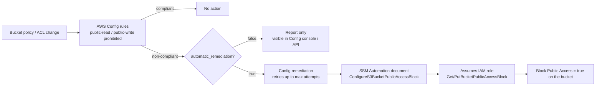

# Public S3 bucket auto-remediation

Terraform module that uses AWS Config to detect publicly readable or writable S3 buckets
and, optionally, remediate them by enabling S3 Block Public Access on the offending bucket.

## How it works



## What this module creates

- Two AWS Config managed rules, `S3_BUCKET_PUBLIC_READ_PROHIBITED` and
  `S3_BUCKET_PUBLIC_WRITE_PROHIBITED`, scoped to `AWS::S3::Bucket` (all buckets).
- An IAM role assumable only by SSM Automation in this account.
- One Config remediation configuration per rule, targeting the AWS-owned SSM document
  `AWSConfigRemediation-ConfigureS3BucketPublicAccessBlock` with parameters
  `AutomationAssumeRole` (the role above) and `BucketName` (`RESOURCE_ID`, the
  non-compliant bucket).

## Prerequisites

- AWS Config configuration recorder and delivery channel already set up and recording
  `AWS::S3::Bucket`. **This module does not create them.**
- Terraform >= 1.9, AWS provider >= 5.0.
- Permissions to create IAM roles, Config rules and Config remediation configurations.

## Usage

Detect only (default): Config flags non-compliant buckets but changes nothing.

```hcl
module "s3_public_remediation" {
  source = "github.com/zeinhaidara/18-terraform-s3-public-remediation"
}
```

Automatic remediation:

```hcl
module "s3_public_remediation" {
  source = "github.com/zeinhaidara/18-terraform-s3-public-remediation"

  automatic_remediation     = true
  remediation_max_attempts  = 5
  remediation_retry_seconds = 60
}
```

A sample variable file is in `example.tfvars`.

## Inputs

| Name | Description | Type | Default |
|------|-------------|------|---------|
| `automatic_remediation` | Remediate non-compliant buckets automatically instead of only reporting. | `bool` | `false` |
| `remediation_max_attempts` | Max remediation attempts within the retry window before Config adds a remediation exception. Must be 1-25. Only used when `automatic_remediation = true`. | `number` | `5` |
| `remediation_retry_seconds` | Retry window in seconds. Must be 1-2678000. Only used when `automatic_remediation = true`. | `number` | `60` |
| `tags` | Tags applied to the IAM role. | `map(string)` | `{}` |

## Outputs

| Name | Description |
|------|-------------|
| `remediation_role_arn` | ARN of the IAM role SSM assumes to run the remediation document. |
| `config_rule_names` | Names of the Config rules created by this module. |

## IAM

- **Permissions:** exactly `s3:GetBucketPublicAccessBlock` and `s3:PutBucketPublicAccessBlock`.
  These are what the document's steps call (`PutPublicAccessBlock`, then
  `GetPublicAccessBlock` to verify). No object access, no bucket policy changes.
- **Resource is `"*"`** because the buckets to remediate are unknown at plan time. The
  blast radius is limited by the two actions, which only touch Block Public Access settings.
- **Trust policy:** principal `ssm.amazonaws.com`, with `aws:SourceAccount` equal to the
  current account and `aws:SourceArn` matching
  `arn:<partition>:ssm:*:<account>:automation-execution/*` (confused-deputy protection).

## Verification runbook (sandbox account only)

1. Apply the module with `automatic_remediation = false`.
2. Create a test bucket, disable its Block Public Access and make it public via ACL or policy.
3. In the Config console, confirm both rules evaluate the bucket as `NON_COMPLIANT`.
4. Set `automatic_remediation = true` and apply. Re-evaluate the rule, then watch the
   remediation run under Systems Manager > Automation.
5. Confirm all four Block Public Access flags are `true`:
   `aws s3api get-public-access-block --bucket <bucket>`.

```text
<PLACEHOLDER: paste real output from a sandbox run here. No live run has been done yet.>
```

## Limitations

- **No tag-based exemption.** AWS Config rule scope `tag_key`/`tag_value` *includes only*
  resources with that tag; it cannot exclude them, so an earlier version of this module
  that used it evaluated only the exempt buckets. The feature was removed. To stop
  remediation for a specific bucket, add a Config remediation exception, for example
  `aws configservice put-remediation-exceptions` (resource type `AWS::S3::Bucket`, with
  the bucket name as resource ID). This is not managed by this module.
- **Account-level S3 Block Public Access is not configured.** Setting it is an optional
  follow-up (see AWS document `AWSConfigRemediation-ConfigureS3PublicAccessBlock` or the
  `aws_s3_account_public_access_block` resource).
- Config evaluates after a change is recorded, not instantly; there is a delay between a
  bucket becoming public and remediation.
- Azure Blob containers are not covered (AWS only).
- Automatic remediation changes bucket settings with no human in the loop. Buckets that
  are intentionally public (e.g. static websites) will be locked down.
- The remediation document waits a stabilization period (default 300 s) before its final check.

## Testing status

- Run: `terraform fmt -check`, `terraform validate`, `terraform test` (mocked AWS provider,
  no AWS calls) and, in CI, tflint and a Trivy config scan.
- The SSM document's definition and Config API limits were checked read-only against AWS.
- **Not run:** any live deployment. Config evaluation, the remediation execution, and the
  trust policy's `aws:SourceArn` format have not been exercised against a real account.
